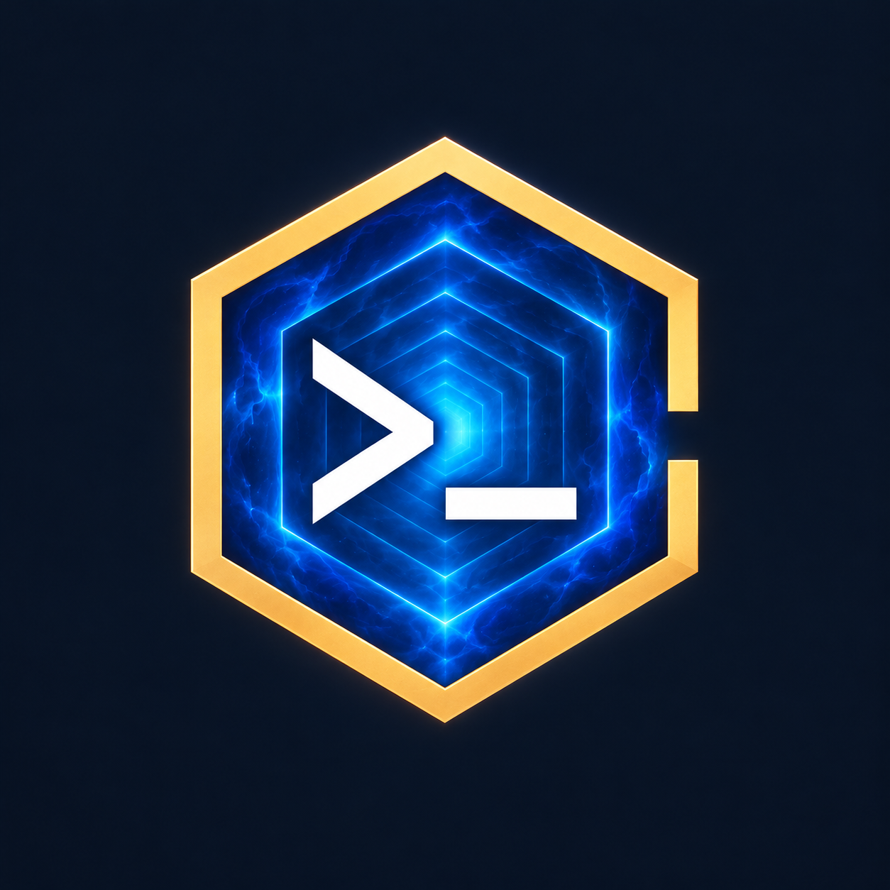

<p align="center">
  
</p>

# Hexgate

**A native Android SSH workspace for foldable phones and tablets.**

Hexgate connects to your development machine over SSH, keeps a native terminal beside
local document previews, and works with named [Herdr](https://github.com/herdrdev/herdr)
sessions. It is built with Kotlin, Jetpack Compose, SSHJ, and the Termux terminal libraries.


## Features

- **Native terminal:** ANSI/VT rendering, Unicode and CJK fallback, Nerd Fonts, hardware
  keyboards, Android IME input, and an accessory key bar with Enter next to Tab.
- **SSH profiles:** imported OpenSSH private keys or saved account passwords, memory-only key
  passphrases, explicit SHA256 host-key trust, and Android Keystore encryption for stored credentials.
- **Persistent workspace:** foreground connection service, optional battery optimization
  exemption, reconnect to named Herdr sessions, and terminal display refresh.
- **Adaptive layout:** fold/cover resizing, terminal/preview split on wide windows, and an
  immersive full-screen toggle that hides Android status and navigation bars.
- **Local previews:** Markdown, Mermaid, static HTML, standalone and embedded draw.io, plus
  document-relative resources fetched over SFTP.
- **Desktop-style selection:** mouse drag, Ctrl+Shift+drag rectangular selection, context-menu
  copy/paste, and Ctrl+Shift+C/V. Plain Ctrl+C/V retain terminal behavior.
- **Appearance:** three bundled Nerd Font Mono families and seven theme choices.

## Quick start

1. Make an SSH server reachable from your Android device. For WSL and optional Tailscale
   access, follow the [connection guide](docs/connection-guide.md).
2. Install the [packaged 0.1.15 APK](packages/README.md) or build the app locally.
3. Open the left drawer and add a connection. Choose **Private key** and import a dedicated key,
   or choose **Password** and enter the SSH account password to store it encrypted.
4. Compare the displayed host fingerprint with the fingerprint obtained directly on the
   server before accepting it.
5. Optionally enter a dedicated Herdr session name to attach to a persistent remote workspace.

See the [user guide](docs/user-guide.md) for connection profiles, previews, permissions,
keyboard shortcuts, selection, and full-screen mode.

## Build

Requirements: **JDK 17**, Android SDK **Platform 36 / Build Tools 36.0.0**, and network access
for the initial Gradle dependency download. The Gradle wrapper is included.

Set `ANDROID_HOME` or create an ignored `local.properties` containing your own `sdk.dir`, then run:

```sh
./gradlew :app:assembleDebug :app:testDebugUnitTest :app:lintDebug
```

The APK is written to `app/build/outputs/apk/debug/app-debug.apk`.

```sh
adb install -r app/build/outputs/apk/debug/app-debug.apk
```

Renderer bundles and font assets are checked in, so normal Android builds do not require
Node.js. Rebuilding JavaScript assets is covered in [renderers/README.md](renderers/README.md).
Debug builds use each developer's local debug signing key. Replacing an existing installation
requires the same signing certificate; debug APKs from different machines may not update in place.

## Controls

| Action | Input |
| --- | --- |
| Open connections, preview, or settings | Left drawer |
| Show Android keyboard | Tap the terminal or press **Keyboard** |
| Refresh terminal display | Header refresh icon |
| Enter or leave immersive mode | Header full-screen icon |
| Select text | Left mouse drag |
| Select a rectangular block | **Ctrl+Shift+drag** |
| Copy / paste | **Ctrl+Shift+C / Ctrl+Shift+V**, or the context menu |
| Send terminal control input | **Ctrl+C / Ctrl+V** |
| Send mouse drag to a remote TUI | **Alt+drag**, with Select mode off |

## Documentation

- [User guide](docs/user-guide.md)
- [Connection and WSL setup](docs/connection-guide.md)
- [Architecture and design](docs/design.md)
- [Build and test instructions](CONTRIBUTING.md)
- [Validation results and limitations](docs/validation.md)
- [Changelog](CHANGELOG.md)
- [Dependency provenance](docs/dependencies.md) and [third-party notices](THIRD_PARTY_NOTICES.md)
- [Security model and reporting](SECURITY.md)

## Project status

Version **0.1.13** is a development build. Generic foldable and tablet Android emulators have
been exercised with real SSH, SFTP, and isolated Herdr sessions. They do not emulate Samsung
firmware. Physical Samsung IME/Bluetooth input, DeX/taskbar behavior, long screen-off operation,
and external-network reachability require device-specific validation.

Background services improve connection lifetime; Android force-stop, device power policies,
network loss, or server shutdown can still terminate SSH. HTML preview is intentionally static.
No arbitrary document JavaScript, public preview server, or automatic router configuration is required.

## Licensing

See [THIRD_PARTY_NOTICES.md](THIRD_PARTY_NOTICES.md) for upstream code, renderer, font, and
palette licenses. Third-party notices are also packaged in the app. The repository is private;
its first-party licensing policy is recorded in [LICENSE](LICENSE).

## Tizen NUI development port

The `tizen` branch includes a native C#/.NET8 NUI port under `tizen/`. See
[its README](tizen/README.md) and [current acceptance audit](tizen/docs/acceptance.md)
for the signed emulator artifact, verification and physical-device boundaries.
Remaining-goal emulator regression passed; physical-device verification is a separate
follow-up. Android remains the behavior reference.
